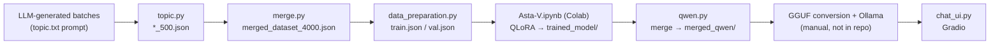

# Asta – an astronomy chatbot

Asta is a small astronomy question-answering chatbot. It is built by fine-tuning
**Qwen2.5-1.5B-Instruct** with **QLoRA** on a hand-built dataset of about 4,000
astronomy Q&A pairs, then serving the result locally through **Ollama** with a
**Gradio** chat interface.

This is a personal second-year BSc Computer Science project. This README
describes the project **as it is today**, including its known problems.

## Repository contents

| File | What it does |
|---|---|
| `chat_ui.py` | Gradio chat window. Sends each message to a local Ollama model called `asta` and shows the reply. |
| `qwen.py` | Loads the Qwen2.5-1.5B-Instruct base model, applies the LoRA adapter from `./trained_model`, merges them and saves the result to `./merged_qwen`. |
| `cleaning.py` | One-off script that removed stray `**` markdown from answers in an early galaxies file. Its input file is no longer in the repo. |
| `main.py` | Empty. |
| `data/*_500.json` | The source dataset: eight topic files (black holes, cosmology, galaxies, gravity, light, planets, stars, time), roughly 500 Q&A pairs each. |
| `data/topic.txt` | The topic checklist and the prompt used to generate the Q&A pairs with an LLM in batches. |
| `data/topic.py` | Joins a topic's two generation batches into `<topic>_500.json` and reports exact duplicate questions. |
| `data/merge.py` | Joins all `*_500.json` files into `merged_dataset_4000.json`. |
| `data/data_preparation.py` | Adds an `"answer astronomy question about {topic}:"` prefix, shuffles with seed 42 and splits 80/20 into `train.json` / `val.json`. |
| `data/train.py` | **Older experiment**: full fine-tuning of `google/flan-t5-small`. It is not the script that produced the current Qwen model. |
| `data/counting.py` | Helper that counts Q&A pairs in a JSON file. |

### Where the Qwen training lives

The QLoRA training of Qwen2.5-1.5B-Instruct was done in Google Colab (Tesla T4)
in the notebook `Asta-V.ipynb`, which is currently **outside this repository**.
It uses 4-bit NF4 quantisation (bitsandbytes) with LoRA (peft) on the attention
projections. The adapter was trained in more than one run, and the code for one
of those runs is not in the notebook.

## Data and model flow



The model files (`trained_model/`, `merged_qwen/`, `*.gguf`) are several GB and
are not stored in Git.

## Running the chat UI

This assumes an Ollama model called `asta` has already been created on your
machine. The steps to create it are not yet documented in this repo.

```bash
pip install -r requirements.txt
ollama serve          # if Ollama is not already running
python chat_ui.py
```

Then open the local URL that Gradio prints (usually http://127.0.0.1:7860).

## Known limitations and planned improvements

1. **Training is not reproducible from this repo.** The Qwen training is in a
   notebook outside the repo, and the adapter was trained with two different
   prompt formats. Training also used an `"answer astronomy question about
   {topic}:"` prefix that the chat UI never sends. *Planned:* a single
   `train_qlora.py` with one fixed "prompt contract" (an Asta system prompt
   plus the plain question), used identically in training, the Ollama
   Modelfile and the chat UI. It will also set a seed and pin package versions.
2. **The dataset has quality issues.** Topic labels are inconsistent
   (`Cosmology`, `black_holes`, `Light`…). There are about 129 duplicate
   questions once case and punctuation are ignored, many across topics.
   31 validation questions also appear in the training set, and the split is
   not stratified by topic. *Planned:* a `prepare_data.py` that cleans,
   de-duplicates and splits the data into chat-format JSONL, leaving the
   original `*_500.json` files untouched.
3. **The chatbot has no memory and no error handling.** `chat_ui.py` sends only
   the latest message, so earlier turns are forgotten. If Ollama is not running
   it crashes with a traceback. *Planned:* use Ollama's `/api/chat` with the
   conversation history and the same system prompt, and show friendly error
   messages.
4. **Answers are short.** Most training answers are around 7–14 words, so Asta
   tends to reply in one sentence. *Possible later extension:* a simple
   FAISS-based retrieval step (RAG) that adds relevant astronomy text to the
   prompt.
5. **There are no tests yet.** *Planned:* basic pytest tests for data
   validation, prompt formatting and the train/validation leakage check.

Other gaps: the GGUF conversion and Ollama Modelfile are not in the repo, and
`requirements.txt` is not version-pinned yet.
