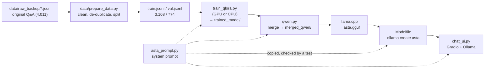

# Asta – an astronomy chatbot

Asta is a small astronomy question-answering chatbot. It is built by fine-tuning
**Qwen2.5-1.5B-Instruct** with **LoRA** (QLoRA on a GPU, plain LoRA on a
CPU) on a hand-checked dataset of 3,882 astronomy Q&A pairs, then serving the result locally through **Ollama** with a
**Gradio** chat interface.

This is a personal second-year BSc Computer Science project.

## How it fits together



### The prompt contract

A fine-tuned model only behaves well when it is asked questions in the format
it was trained on. [asta_prompt.py](asta_prompt.py) defines that format once:
an Asta **system prompt**, then the **plain question**, then the answer.
Training, the merge check and the chat UI all import it. The Ollama
`Modelfile` cannot import Python, so it repeats the prompt, and a test checks
the two copies are identical.

## Repository contents

| File | What it does |
|---|---|
| `asta_prompt.py` | The system prompt, `build_chat()` (adds it to a conversation) and `make_labels()` (masks prompt tokens so training only learns from answers). |
| `train_qlora.py` | QLoRA fine-tuning of Qwen2.5-1.5B-Instruct on `data/train.jsonl`. Uses QLoRA on a GPU (e.g. a Colab T4), or plain LoRA on a CPU. Writes the adapter to `trained_model/`. |
| `qwen.py` | Checks the adapter, merges it into the base model, asks a test question and saves `merged_qwen/`. Runs on a CPU. |
| `Modelfile` | Tells Ollama how to run `asta.gguf`: Qwen's chat template, the system prompt and the stop token. |
| `chat_ui.py` | Gradio chat window. Sends the system prompt, recent history and the new question to Ollama's `/api/chat`, with friendly messages if Ollama is not running, the model is missing or a reply times out. |
| `tests/` | pytest tests for the data, the prompt contract and the chat logic. |
| `requirements.txt` | Packages for running the chat UI, merging and tests on your own computer. |
| `requirements-train.txt` | Packages for training on Colab. |
| `data/raw_backup/*_500.json` | **Source of truth.** Unmodified copies of the eight original topic files (black holes, cosmology, galaxies, gravity, light, planets, stars, time). Never edited. |
| `data/prepare_data.py` | Cleans the raw files and builds the training data (see below). |
| `data/answer_fixes.json` | 63 hand-checked replacement answers, each with a reason: factual errors and misleading answers found by reading the whole dataset, contradictory duplicates, and sentence fragments. |
| `data/*_500.json` | Cleaned working copies written by `prepare_data.py` (3,882 pairs). |
| `data/train.jsonl`, `data/val.jsonl` | Chat-format training and validation sets (3,108 / 774). |
| `data/data_quality_report.txt`, `data/duplicate_review.json` | Report from the last data run, and every duplicate group with all its answer versions and the one kept. |
| `data/topic.txt`, `data/topic.py` | The prompt used to generate the Q&A pairs with an LLM, and the script that joined each topic's two batches. |

**Older files, kept for reference:**

| File | What it was |
|---|---|
| `data/merge.py`, `data/data_preparation.py` | The first data pipeline, replaced by `prepare_data.py`. It added an `"answer astronomy question about {topic}:"` prefix and produced `merged_dataset_4000.json`, `train.json` and `val.json`. Those files are what the **current** Asta model was trained on. |
| `data/train.py` | An earlier experiment: full fine-tuning of `google/flan-t5-small`. |
| `cleaning.py`, `data/counting.py` | One-off helpers whose input files are no longer in the repo. |
| `main.py` | Empty. |

The model files (`trained_model/`, `merged_qwen/`, `*.gguf`) are several GB and
are not stored in Git.

## 0. Setting up

You need Python 3.12 and [Ollama](https://ollama.com). In the project folder:

```bash
python -m venv .venv
.venv\Scripts\activate            # Windows (macOS/Linux: source .venv/bin/activate)
pip install torch==2.15.0 --index-url https://download.pytorch.org/whl/cpu
pip install -r requirements.txt
```

## 1. Preparing the data

```bash
python data/prepare_data.py
```

The script reads only `data/raw_backup/`, so it can be re-run safely and gives
the same output every time (seed 42). It:

1. checks every record has a non-empty `topic`, `question` and `answer`;
2. tidies whitespace and converts topic labels to snake_case
   (`Cosmology` → `cosmology`, `Light` → `light`);
3. removes duplicate questions within and across topics. Questions are
   compared after lowercasing and removing punctuation. From each duplicate
   group it keeps the copy with the longest answer, and it lists every group
   in `duplicate_review.json` for manual checking;
4. applies the hand-checked answers in `answer_fixes.json`;
5. writes the cleaned `*_500.json` working files;
6. splits each topic 80/20 separately (a stratified split), so both sets have
   the same topic mix. A validation record whose answer is identical to a
   training answer (a reworded question) is moved into training;
7. stops with an error if any validation question or answer also appears in
   training;
8. writes `train.jsonl` / `val.jsonl` in the chat `messages` format and
   `data_quality_report.txt`.

## 2. Training

`train_qlora.py` uses **QLoRA** on an NVIDIA GPU. Without a GPU it falls
back to **plain LoRA on the CPU**, because 4-bit quantisation (bitsandbytes)
needs a GPU. Only the precision of the frozen base weights differs: same
LoRA settings, same data, same effective batch size.

**On your own computer (no GPU):**

```bash
python train_qlora.py
```

On an 8-core laptop CPU (Intel Core Ultra 5 226V) the full run took about
7 hours for 2 epochs (778 steps) and needs about 8 GB of free RAM. Plugged
in, a step took 15–18 seconds; on battery Windows slowed it to about 38
seconds and paused it whenever the laptop went to sleep, so keep the laptop
plugged in with the lid open.

That run reached a validation loss of 1.342 after epoch 1 and 1.325 after
epoch 2 (training loss 1.316).

**On Google Colab**, in a notebook with a **T4 GPU** runtime:

```
!git clone <your repository URL>
%cd Asta-Chatbot
!pip install -r requirements-train.txt
!python train_qlora.py
```

Then download the `trained_model/` folder (for example, zip it and use
`files.download`) and put it in the project folder on your computer.

What the script does:
- on a GPU, loads the base model with **4-bit NF4 weights** (bitsandbytes) to
  fit in T4 memory; on a CPU, loads it in float32. Either way the base model
  is frozen and only trainable **LoRA** matrices (rank 16, alpha 32) on the
  attention layers are trained;
- adds the system prompt to every example and applies Qwen's own chat template;
- **masks the prompt tokens** (labels = -100), so the loss is only computed on
  the answer;
- trains for 2 epochs (learning rate 2e-4, effective batch size 8), evaluates
  on the validation set after each epoch and keeps the checkpoint with the
  **lowest validation loss**;
- sets a fixed seed (42), prints the library versions, and prints answers to
  a few sample questions at the end.

`TRAIN_MLP_LAYERS` in `train_qlora.py` switches LoRA on for the MLP layers
too. That trains about 4 times as many parameters (≈18M instead of ≈4.4M),
which may learn the facts better but is slower and more likely to overfit.

## 3. Merging and loading into Ollama

```bash
python qwen.py
```

`qwen.py` stops early if `trained_model/` is missing or was trained on a
different base model. After merging it asks one test question and prints the
answer before saving `merged_qwen/`.

Ollama cannot import a Qwen2 model straight from `merged_qwen/` (it reports
"unsupported architecture"), so convert it to GGUF with
[llama.cpp](https://github.com/ggml-org/llama.cpp)'s converter first. The
converter only needs its `gguf` package; nothing has to be compiled.

```bash
git clone --depth 1 https://github.com/ggml-org/llama.cpp
pip install ./llama.cpp/gguf-py sentencepiece
python llama.cpp/convert_hf_to_gguf.py merged_qwen --outfile asta.gguf --outtype q8_0
ollama create asta -f Modelfile
```

`q8_0` (8-bit) keeps quality close to the original at about half the size of
float16.

## 4. Running the chat UI

```bash
ollama serve          # if Ollama is not already running
python chat_ui.py
```

Then open the local URL that Gradio prints (usually http://127.0.0.1:7860).

To compare Asta with the original, untuned model, point the UI at a different
Ollama model with the `ASTA_MODEL` environment variable. For example, after
`ollama pull qwen2.5:1.5b-instruct`:

```bash
set ASTA_MODEL=qwen2.5:1.5b-instruct      # Windows (macOS/Linux: export ASTA_MODEL=...)
python chat_ui.py
```

## Tests

```bash
pytest
```

The tests cover:
- **data:** chat format, no topic prefix, no train/validation leakage, no
  duplicates, snake_case topics, every answer fix applied, and the
  split/leak/normalisation helpers;
- **prompt contract:** system prompt placement, label masking, and that the
  `Modelfile` prompt matches `asta_prompt.py`;
- **chat UI:** history handling and every error path, using a fake Ollama
  response so no model is needed.

The training and merge scripts need a GPU or a large download, so they are
not covered by the tests.

## Known limitations

1. **Asta still makes factual mistakes.** After training on the CPU, it
   answered "Why is time slower near a black hole?" with "Gravity increases
   the passage of time", which is the wrong way round. A 1.5B model trained
   for 2 epochs on short answers learns the style of the answers more
   reliably than the facts. The earlier Asta, trained in `Asta-V.ipynb` on
   the old data, is replaced by this one.
2. **Answers are short.** Most training answers are one sentence (about
   7–14 words), so Asta tends to reply briefly.
3. **Single-turn training.** Asta was trained on single questions. The chat
   UI sends the last 10 messages so follow-up questions have context, but
   the model has never seen multi-turn conversations in training.
4. **Reworded duplicates.** Reworded questions are only kept in the same
   split when their answers are identical. Rewordings with differently
   worded answers can still be in both training and validation.
5. **The data was generated by an LLM** and checked by one careful manual
   read, not an expert review.
6. **The GPU (QLoRA) path has not been re-run** since moving it out of the
   notebook. The full CPU training run, the merge, the Ollama Modelfile and
   the chat UI have all been run with the pinned versions in
   `requirements.txt`.
